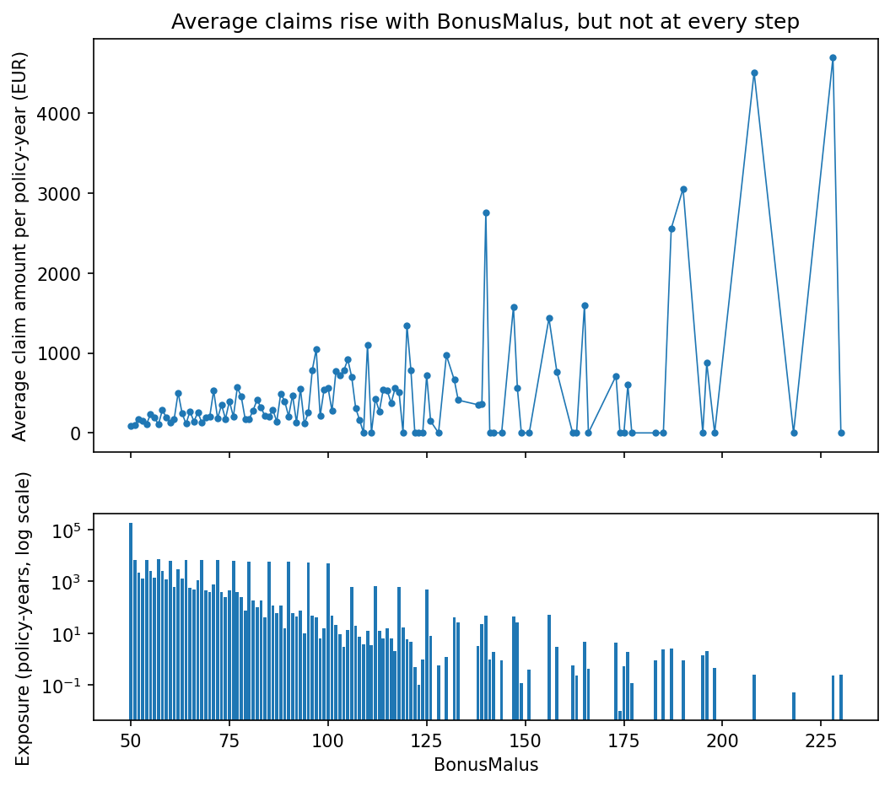
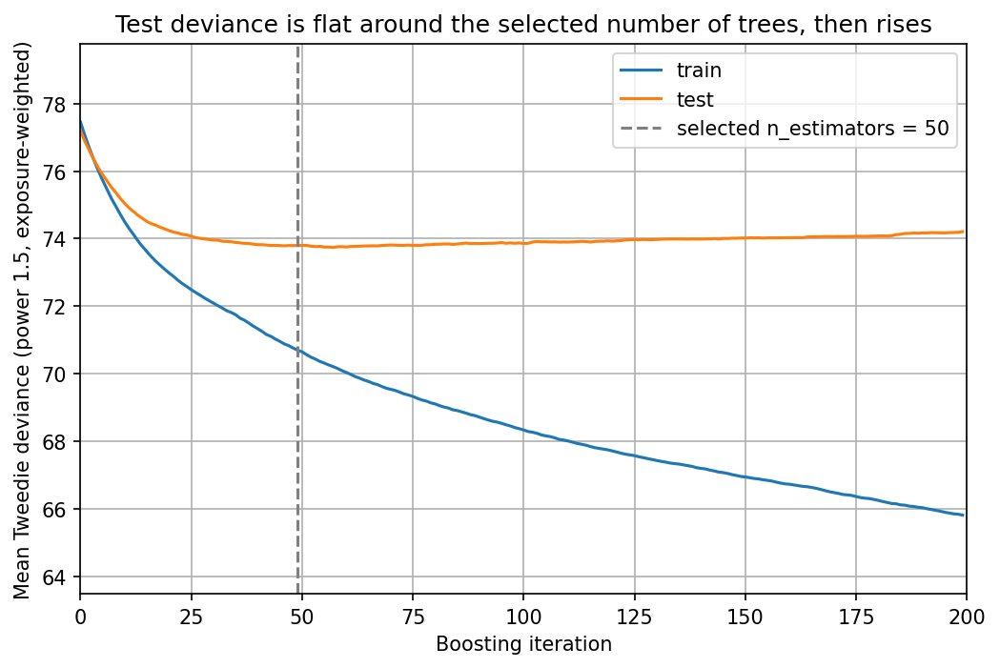
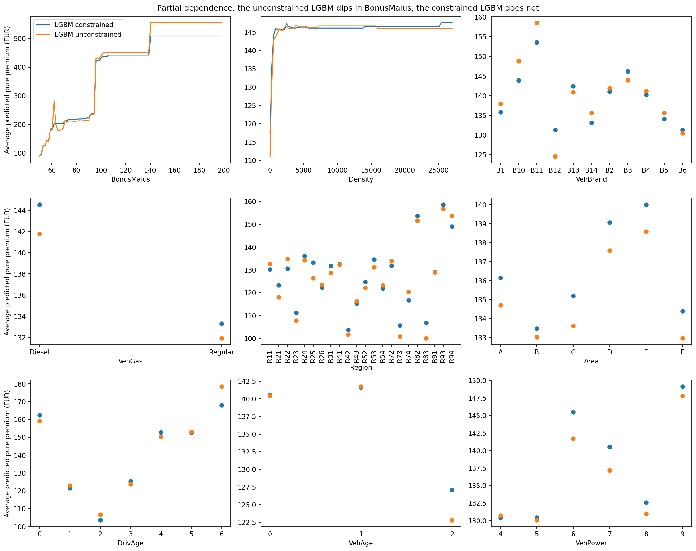
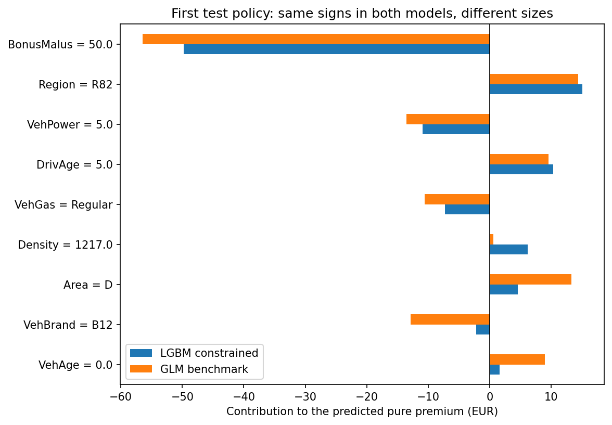

# Problem Set 3: Claims modelling exercise

## Setup

```
mamba env create
conda activate ps3

pre-commit install
pip install --no-build-isolation -e .
```

`conda env create` works in place of `mamba env create`.

## Usage

```
pytest
python analyses/ps3_script.py
```

`load_transform` downloads the two raw files from OpenML on the first run and
stores them in `data/`, which git ignores. Later runs read the local copies.
The script takes about five minutes and writes its figures to `figures/`.

## Problem set 3

All numbers come from one run of `analyses/ps3_script.py` with Python 3.12,
glum 3.4.1, LightGBM 4.7.0 and scikit-learn 1.9.1. "Deviance" is the mean
Tweedie deviance (power 1.5) weighted by exposure, as printed by the script.

### Ex 1: Fixed train/test split

The function is `create_sample_split` in `ps3/data/_sample_split.py`. The
problem set calls it `create_sample_column`; I kept the name the repository
already imports. I also corrected the docstring, which gave 0.9 as the default
`training_frac` while the signature uses 0.8.

Each ID is converted to text, hashed with `hashlib.md5`, and reduced modulo 100
to a bucket. Buckets below `training_frac * 100` are "train" and the rest
"test". I chose the hash over a plain `IDpol % 100` so that the split does not
depend on any pattern in how IDs were assigned. I did not use Python's
built-in `hash()`, because it is salted per session for strings and would give
a different split on every run. The function accepts one column or a list of
columns and returns a copy of the data.

On the claims data the split gives 542,757 training rows and 135,256 test rows
(80.05% and 19.95%).

### Ex 2: Winsorizer

`Winsorizer` in `ps3/preprocessing/_winsorizer.py` follows the scikit-learn
conventions. `__init__` only stores `lower_quantile` and `upper_quantile`.
`fit` validates them, computes the quantiles per column, stores them as
`lower_quantile_` and `upper_quantile_`, and returns `self`. `transform` calls
`check_is_fitted` and clips the data at the stored bounds.

The tests cover the three given quantile pairs with a seeded random generator,
calling `transform` before `fit`, invalid quantiles, 2D and DataFrame input,
and that new data is clipped at the bounds learned in `fit` and not at its own
quantiles. One test runs the Winsorizer as a step of a scikit-learn `Pipeline`.

### Ex 3: Improve the model

| Model | Train deviance | Test deviance | Predicted / observed claims (test) | Gini (test) |
|---|---|---|---|---|
| GLM benchmark | 73.75 | 73.71 | 1.011 | 0.246 |
| GLM with splines | 73.31 | 73.72 | 1.007 | 0.242 |
| LGBM, default settings | 65.10 | 74.04 | not computed | not computed |
| LGBM, tuned | 69.83 | 73.41 | 0.912 | 0.251 |
| LGBM frequency x severity | 71.53 | 72.64 | 0.985 | 0.270 |

**Why is the claim amount divided by exposure?**

Policies are observed for different lengths of time. Exposure runs from 0.003
to 1 year, with a median of 0.49. A policy observed for one month has had less
time to produce claims than one observed for a year, so the raw claim amount
mixes risk with observation time. Dividing by exposure gives the claim amount
per policy-year, the pure premium, which is comparable across policies and is
the quantity an insurer prices.

Exposure is then used as the sample weight. A pure premium measured over a
short period is noisier, so it should count less. With these weights the
weighted mean of the pure premium equals total claims divided by total
exposure.

**How does the deviance change with splines?**

The script adds splines to `BonusMalus` and `Density`. The problem set names
`BonusMalus` and `VehPower`, but the script already treats `VehPower` as a
categorical with one coefficient per level, so I followed the script. Each of
the two features is standardised and expanded into 6 cubic spline columns
(5 knots at quantiles, `include_bias=False`), which replace its single linear
term. The GLM is otherwise the same as the benchmark.

Training deviance falls from 73.75 to 73.31. Test deviance does not improve:
it moves from 73.71 to 73.72, and the Gini index falls from 0.246 to 0.242.
The splines fit the training data better, but the gain does not carry over to
the test set. On this split they are not an improvement over the linear terms.

**How can overfitting be checked?**

Compare the deviance on the training set with the deviance on data the model
has not seen. For the benchmark the two are almost equal (73.75 and 73.71).
With splines the test deviance is 0.41 above the training deviance, and for
the LGBM with default settings the gap is 8.94 (65.10 and 74.04). A training
loss that keeps falling while the test loss stays flat or rises is the sign of
overfitting.

A single test set can be lucky or unlucky, and reusing it to choose models
would overfit to it. The better check is k-fold cross-validation on the
training set, which I use below to tune the LGBM. The same approach could
choose the number of spline knots.

**LGBM and tuning**

The LGBM uses the Tweedie objective with power 1.5, the same loss as the GLMs,
and the categorical columns directly. With default settings (learning rate 0.1,
100 trees) it overfits, as shown above.

I tuned `learning_rate` over 0.01, 0.02, 0.05 and 0.1 and `n_estimators` over
25, 50, 100, 200 and 400 with 5-fold cross-validation on the training set. The folds are
shuffled with a fixed seed because the rows are ordered by policy ID. The score
is the exposure-weighted Tweedie deviance on the validation fold. The default
score of `GridSearchCV` is the unweighted R^2, which is not the loss I report.
In an earlier run, an unweighted deviance score selected a learning rate of
0.02 with 50 trees, and that model had a test deviance of 74.07.

The search selects a learning rate of 0.05 with 50 trees (cross-validated
deviance 73.82). A first grid with 50, 100 and 200 trees selected the same
setting, but 50 was then the smallest value in the grid. In the wider grid the
optimum is in the interior: at a learning rate of 0.05, both 25 trees (74.17)
and 100 trees (74.00) score worse. Refitted on the training set, this model has a training
deviance of 69.83 and a test deviance of 73.41. The gap between the two falls
from 8.94 to 3.58, and the test deviance is 0.30 below the GLM benchmark.

Two caveats apply. First, the standard deviation of the score across the five
folds is about 2.9, far larger than the differences between the best grid
points (73.82, 73.82, 73.83 and 73.85 for the top four), so the data do not
separate these settings clearly. Second, the tuned LGBM underpredicts the
level of claims: it predicts 8.92 million on the test set against 9.78 million
observed, 8.8% too low, while both GLMs are within 1.1%. It ranks policies
slightly better than the GLMs (Gini 0.251 against 0.246) but would need
recalibration before its predictions could be used as prices. I have not
investigated the cause of this bias.

**Optional: LGBM frequency and severity models**

The frequency model predicts claims per year with a Poisson objective,
weighted by exposure. The severity model predicts the average amount per claim
with a Gamma objective, weighted by the number of claims, using only the
19,964 training policies with at least one claim. Both use the same grid and
folds as above, scored with their own weighted deviance. The predicted pure
premium is the product of the two predictions.

The frequency search selects a learning rate of 0.05 with 200 trees. The score
is flat around this point: 400 trees at the same learning rate, or at 0.02,
give the same Poisson deviance to four decimals (0.4488).

The severity search selects the smallest setting in the grid, a learning rate
of 0.01 with 25 trees. Its Gamma deviance rises with every increase in either
parameter, from 1.323 to 1.571 at the largest setting. Each extra boosting
step makes the validation fit worse, which suggests that these features
explain very little of the variation in claim size. The optimum is still on
the border of the grid, so an even smaller setting might score slightly
better.

The combined model has a training deviance of 71.53 and a test deviance of
72.64, the lowest test deviance in the table, and the highest Gini index
(0.270). Its predicted test claims are 1.5% below the observed total. This
result is from one train/test split, so the ranking of the models could change
on other data.

## Problem set 4

The code for problem set 4 is at the end of `analyses/ps3_script.py`, after the
comment "Problem set 4 starts here". The numbers come from the same run as the
answers above, with numpy 2.3.5, pandas 2.3.3, dalex 1.8.0 and plotly 7.1.0 in
addition to the versions named there. Figures are saved in `figures/`.

### Ex 1: Monotonicity constraint



**What could happen without a monotonicity constraint?**

The model could predict a lower premium for a customer whose BonusMalus score
is worse.

The plot shows the average claim amount per policy-year for each of the 113
BonusMalus values in the training set. I used total claims divided by total
exposure in each group, which is the exposure-weighted mean of the pure
premium. The average rises with BonusMalus overall, but it falls at 56 of the
112 steps from one value to the next. The data are thin: 62.8% of the exposure
is at BonusMalus 50 and only 1.0% is above 100, so most of the averages are
noisy.

An LGBM without a constraint splits on BonusMalus wherever that lowers the
training loss, also inside branches defined by other features. It can
therefore pick up some of these dips. A customer whose score gets worse would
then pay less, which contradicts what the score is meant to do. The partial
dependence plot in Ex 4 shows that the unconstrained model here does this
around BonusMalus 62.

**How does the constrained LGBM compare with the unconstrained one?**

The constrained model is slightly worse on cross-validated, training and test
deviance.

| LGBM | Selected setting | CV deviance (fold std) | Train deviance | Test deviance | Predicted / observed claims (test) |
|---|---|---|---|---|---|
| Unconstrained | 0.05, 50 trees | 73.82 (2.91) | 69.83 | 73.41 | 0.912 |
| Constrained | 0.05, 50 trees | 73.98 (2.87) | 70.69 | 73.80 | 0.921 |

`constrained_lgbm` is the same pipeline as the unconstrained LGBM with
`monotone_constraints` added: 1 for `BonusMalus` and 0 for the other eight
features, built from the column names of the training data. I kept the grid,
the folds and the scorer, so the constraint is the only difference. Both
searches select a learning rate of 0.05 with 50 trees.

The cross-validated deviance rises by 0.17. That is small next to the standard
deviation across folds of about 2.9, but the two searches use the same folds
and I did not compare them fold by fold (not investigated). The test deviance
rises by 0.38, which puts the constrained LGBM 0.08 above the GLM benchmark
(73.71). The gap between training and test deviance falls from 3.58 to 3.10.
On this split the constraint costs a little accuracy and does not improve the
fit. What it buys is the guarantee that the prediction never falls when
BonusMalus rises and the other features stay the same.

### Ex 2: Learning curve



**What do you notice, is the estimator tuned optimally?**

The number of trees is close to its best value for a learning rate of 0.05,
but I would not call the estimator optimally tuned, because only these two
parameters were searched.

The training deviance falls with every tree: 70.69 after the selected 50 trees
and 65.81 after 200. The test deviance falls quickly at first, is almost flat
from about 40 trees, and reaches its lowest value of 73.74 after 58 trees.
After that it rises slowly, to 74.21 after 200 trees. From there on the model
only fits the training data better, which is overfitting. The selected 50
trees give a test deviance of 73.80, which is 0.05 above the lowest point of
the curve, so the cross-validation picked a sensible place to stop.

Two things limit this conclusion. The test curve is one sample, and moving
`n_estimators` to 58 because of it would be tuning on the test set. The other
tree settings, such as `num_leaves` and `min_child_samples`, are still at
their defaults, and the gap of 3.10 between training and test deviance at 50
trees suggests that simpler trees could be worth trying. I did not test this
(not investigated).

Differences from the sheet. The sheet refits the best estimator as it is. I
refit it with 200 trees and marked the selected 50, because a curve that stops
at 50 cannot show what happens after it. The first 50 trees are the same as in
the selected model: the curve gives 70.69 and 73.80 at 50 trees, the same as
in Ex 1. The curve shows the exposure-weighted mean Tweedie deviance through a
custom `eval_metric`, so it is on the same scale as the other numbers.
LightGBM's own `tweedie` metric is a negative log-likelihood on a different
scale. I pass `eval_set` as the sheet says. LightGBM 4.7.0 marks it as
deprecated in favour of `eval_X` and `eval_y` and prints a warning.

### Ex 3: Metrics function

`evaluate_predictions` is in `ps3/evaluation/_evaluate_predictions.py`. It
takes the predictions, the actuals and a sample weight, and returns a
DataFrame with the metric names as index. The sample weight enters every
metric:

- `bias`: weighted mean prediction minus weighted mean actual, divided by the
  weighted mean actual. With exposure as weight this is predicted total claims
  over observed total claims, minus one.
- `deviance`: weighted mean Tweedie deviance. The power is an argument with
  default 1.5.
- `mae` and `rmse`: weighted mean absolute error and the root of the weighted
  mean squared error.
- `gini`: one minus twice the area under the Lorenz curve, computed as at the
  bottom of `ps3_script.py`.

The sheet does not say whether the bias is absolute or relative. I chose the
relative version because it can be read without knowing the level of the pure
premium. The tests use small examples worked out by hand, check that perfect
predictions give zero bias, deviance, MAE and RMSE, that rescaling the weights
changes nothing, and that the deviance agrees with scikit-learn's
`mean_tweedie_deviance`.

**How do the constrained and the unconstrained LGBM compare?**

On the test set the unconstrained LGBM is better on deviance, MAE, RMSE and
Gini. The constrained LGBM is better only on bias. I added the GLM benchmark
as a reference.

Test set:

| Metric | GLM benchmark | LGBM unconstrained | LGBM constrained |
|---|---|---|---|
| bias | 0.011 | -0.088 | -0.079 |
| deviance | 73.71 | 73.41 | 73.80 |
| mae | 257.3 | 245.2 | 246.8 |
| rmse | 3298.1 | 3297.3 | 3297.4 |
| gini | 0.246 | 0.251 | 0.234 |

Training set:

| Metric | GLM benchmark | LGBM unconstrained | LGBM constrained |
|---|---|---|---|
| bias | 0.012 | -0.091 | -0.083 |
| deviance | 73.75 | 69.83 | 70.69 |
| mae | 259.0 | 246.2 | 247.7 |
| rmse | 4076.8 | 4073.9 | 4074.3 |
| gini | 0.267 | 0.402 | 0.371 |

The deviance and Gini values equal the ones printed earlier in the script, so
the function reproduces the existing calculations.

Both LGBMs predict too little in total, 8.8% and 7.9% on the test set, and the
bias is about the same on the training set. The GLM is 1.1% too high. The
constraint lowers the Gini index on the test set from 0.251 to 0.234, which is
below the GLM (0.246), so the constrained LGBM ranks policies worse than the
benchmark on this split. Both LGBMs rank much better on the training set than
on the test set (0.402 and 0.371 against 0.251 and 0.234), while the GLM
changes little (0.267 against 0.246).

MAE and RMSE say little here. The RMSE differs by less than 1 between the
three models on a level of about 3,298, because a few large claims dominate
it. The MAE favours low predictions: only 19,964 of the 542,757 training
policies have a claim, so for most policies the absolute error is the
prediction itself. The lower MAE of the two LGBMs goes together with their
negative bias and should not be read as a better fit.

### Ex 4: Partial dependence plots



**How do the PDPs of the constrained and the unconstrained LGBM compare?**

They differ where the constraint applies. The unconstrained profile for
`BonusMalus` goes down in places and the constrained one never does. For the
other eight features the two models give similar profiles.

Both `BonusMalus` profiles start at an average prediction of 89 at a score of
50 and rise to more than 500 at the top of the grid (555 unconstrained, 509
constrained). The unconstrained profile falls at 6 of the 100 steps of the
grid. The largest fall is 82.5, at a score of about 63, right after a spike
near 62. This is the case described in Ex 1: with the other features held
fixed, a customer with a score of 63 gets a lower prediction than one with 62.
The constrained profile falls at none of the 100 steps and replaces the spike
with a flat step.

The other panels each have their own vertical axis. Their profiles stay
between about 100 and 180, so `BonusMalus` moves the prediction far more than
any other feature. In these panels the two models are within a few euros of
each other and order the categories in nearly the same way. The largest
visible gaps are of the order of 5 to 10 (for example `VehBrand` B12 and
`DrivAge` group 6). I read these from the plot and did not compute them.

Limits of the plot. The profiles are unweighted averages over 1,000 policies
sampled from the test set, the same policies for both models. The `BonusMalus`
grid ends at 198, the highest score in that sample. Few policies have a score
above 100 (1.0% of the training exposure), so the upper part of both curves
rests on little data. A PDP also sets `BonusMalus` to every grid value for
every policy, including values that such a policy would rarely have.

Differences from the sheet. The sheet suggests downgrading numpy below 2 if
the `ptp` error appears. It did appear, in the plot method of dalex 1.7.0, the
newest version on conda-forge. I installed dalex 1.8.0 from PyPI instead,
which works with numpy 2.3.5, so the other packages and the earlier numbers
stay as they were. The figure above is drawn with matplotlib from the profiles
that dalex computes, so that it shows on GitHub. The interactive dalex plots
are saved as `figures/ps4_ex4_pdp_numerical.html` and
`figures/ps4_ex4_pdp_categorical.html` and can be opened in a browser.

### Ex 5: Shapley



**Where do the decompositions of the constrained LGBM and the GLM differ?**

For the first policy of the test set the two models agree on the sign of all
nine contributions and on the largest ones. They differ in how much they give
to `VehBrand`, `VehAge`, `Area` and `Density`.

The policy has BonusMalus 50, region R82, area D, density 1,217, vehicle brand
B12, regular fuel, and groups 5, 0 and 5 for driver age, vehicle age and
vehicle power. The LGBM predicts 105.19 and the GLM 100.81. The contributions
add up to the difference between this prediction and the average prediction
of the model, which is 137.70 for the LGBM and 147.45 for the GLM.

| Feature | LGBM constrained | GLM benchmark |
|---|---|---|
| BonusMalus = 50 | -49.79 | -56.49 |
| Region = R82 | 15.08 | 14.41 |
| VehPower = 5 | -10.94 | -13.55 |
| DrivAge = 5 | 10.34 | 9.55 |
| VehGas = Regular | -7.27 | -10.59 |
| Density = 1217 | 6.14 | 0.60 |
| Area = D | 4.58 | 13.28 |
| VehBrand = B12 | -2.23 | -12.84 |
| VehAge = 0 | 1.59 | 9.00 |

In both models the BonusMalus score of 50, the lowest in the data, is by far
the largest contribution and pulls the prediction down by 50 to 56. `Region`,
`VehPower`, `DrivAge` and `VehGas` are within 3.4 of each other across the two
models.

The GLM gives `VehBrand` B12 a contribution of -12.84 and the lowest vehicle
age group one of 9.00, against -2.23 and 1.59 in the LGBM. The GLM has one
coefficient for each category, which applies to every policy in it, while the
LGBM only splits on a category where that lowers the loss. I did not check
whether this is the reason for the difference (not investigated).

`Area` and `Density` should be read together, because `Area` is a banded
version of `Density`. The GLM puts almost all of the effect on `Area` (13.28
against 0.60 for `Density`), the LGBM splits it between the two (4.58 and
6.14). The sums are closer: 13.88 and 10.72.

The two baselines also differ by 9.75. The LGBM predicts less on average than
the GLM, which matches its negative bias in Ex 3.

Limits. This is one policy and the pattern may be different for others. dalex
computes the values on the scale of the prediction, in euros, for both models,
and not on the linear predictor of the GLM. They are averages over 25 random
orderings of the features with 1,000 sampled test policies as background, so
they would change a little with another seed. I did not check how much (not
investigated). The interactive dalex plot is saved as
`figures/ps4_ex5_shap.html`.
